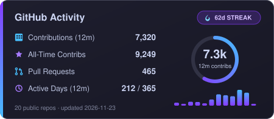
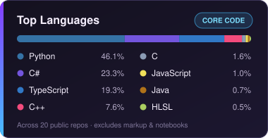

  

  
  
  

I build production MCP platforms, self-rendering GenUI, and cloud infrastructure — with a background in real-time graphics.

- 🧠 **Agentic AI & MCP** — FastMCP, LangGraph, GOAP, pgvector
- 💻 **Full-Stack & GenUI** — React 19, TypeScript, Python, Node.js, SolidJS
- ☁️ **Cloud & DevOps** — AWS, Terraform, Docker, EKS, GitHub Actions
- 🎮 **Real-Time Graphics** — Unity, Unreal Engine 5, Three.js / WebGL, HLSL/GLSL

## Featured Projects

  

| Project | Overview |
| :--- | :--- |
| [**Whiskers-Agent**](https://github.com/CooLguNxDD/Whiskers-Agent) | Plugin-driven MCP platform with `FastMCP` (stdio & HTTP), LangGraph/GOAP orchestration, two-layer OAuth, encrypted vault, and React admin console |
| [**Whiskers-Agent-Chat**](https://github.com/CooLguNxDD/Whiskers-Agent-Chat) | Shared chat & task board for coding-agent fleets built on `FastMCP` + SQLite, SolidJS portal, webhooks, and Discord relay |
| [**Claude-Idle-Cat**](https://github.com/CooLguNxDD/Claude-Idle-Cat) | Claude Code plugin where an idle cat earns coins while you code, complete with a household and six browser arcade games |
| [**The-Daily-Directive-Game**](https://github.com/CooLguNxDD/The-Daily-Directive-Game) | Co-op photo roguelike shooter in Unreal Engine 5.9 (`C++`, Epic AI MegaJam 2026 · [Watch Demo](https://youtu.be/xV4vN-_Von8)) |

## Statistics

  

Self-hosted SVG cards generated via <a href="./scripts/generate_stats.py"><code>scripts/generate_stats.py</code></a> and <a href="./.github/workflows/update-stats.yml">GitHub Actions</a> — zero third-party OAuth apps.

## Tech Stack

  

| Area | Stack |
| :--- | :--- |
| **Agentic AI** | MCP · FastMCP · LangGraph · GOAP · Pydantic · RAG / pgvector |
| **Frontend & GenUI** | React 19 · SolidJS · TypeScript · TanStack · Zustand · Zod · Tailwind v4 · Three.js |
| **Backend** | Python · Node.js · FastAPI · PostgreSQL · SQLite · Redis · Nginx |
| **Cloud & DevOps** | AWS (EKS, Lambda, DynamoDB, SQS, Amplify) · Terraform · Docker · GitHub Actions |
| **Graphics** | Unity · Unreal Engine 5 · C# / C++ · HLSL / GLSL · Blender |

## AI Tools

<table>
  <tr>
    <td align="center" width="120">
       
      <b>Claude Code</b>
    </td>
    <td align="center" width="120">
       
      <b>Antigravity</b>
    </td>
    <td align="center" width="120">
       
      <b>Codex</b>
    </td>
    <td align="center" width="120">
       
      <b>Grok</b>
    </td>
  </tr>
</table>
