### Hi there

## I am Andrew Liang

**Full-Stack & Agentic AI Systems Engineer** · Vancouver, BC

I build production MCP platforms, self-rendering GenUI, and cloud infrastructure — with a background in real-time graphics.

- 🧠 **Agentic AI / MCP** — FastMCP, LangGraph, GOAP, pgvector
- 💻 **Full-Stack** — React 19, TypeScript, Python, Node.js
- ☁️ **Cloud & DevOps** — AWS, Terraform, Docker, EKS
- 🎮 **Real-Time Graphics** — Unity, Unreal, Three.js / WebGL

🔭 Building [Whiskers Agent](https://github.com/CooLguNxDD/Whiskers-Agent) — plugin-driven MCP + LangGraph/GOAP platform  
📫 [LinkedIn](https://www.linkedin.com/in/andrew-liang-8281301b5/) · [Itch.io](https://coolgunxdd.itch.io) · [CatPortfolio](https://coolgunxdd.github.io/CatPortfolio/)

## Portfolio

## Tech Stack

  

| Area | Stack |
| :--- | :--- |
| **Agentic AI** | MCP · FastMCP · LangGraph · GOAP · Pydantic · RAG / pgvector |
| **Frontend & GenUI** | React 19 · TypeScript · TanStack · Zustand · Zod · Tailwind v4 · Three.js |
| **Backend** | Python · Node.js · FastAPI · PostgreSQL · Redis · Nginx |
| **Cloud & DevOps** | AWS (EKS, Lambda, DynamoDB, SQS, Amplify) · Terraform · Docker · GitHub Actions |
| **Graphics** | Unity · Unreal Engine 5 · C# / C++ · GLSL · Blender |

## AI Tools

<table>
  <tr>
    <td align="center" width="120">
       
      <b>Claude Code</b>
    </td>
    <td align="center" width="120">
       
      <b>Antigravity</b>
    </td>
    <td align="center" width="120">
       
      <b>Codex</b>
    </td>
    <td align="center" width="120">
       
      <b>Grok</b>
    </td>
  </tr>
</table>

## Statistics

