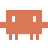

<p align="center">
  <picture>
    <source media="(prefers-color-scheme: light)" srcset="./assets/light/hero-banner.svg" />
    
  </picture>
</p>

<p align="center">
  <a href="https://coolgunxdd.github.io/CatPortfolio/"></a>
  <a href="https://www.linkedin.com/in/andrew-liang-8281301b5/"></a>
  <a href="https://coolgunxdd.itch.io"></a>
</p>

I architect **Agentic AI platforms**, **self-rendering GenUI**, and **distributed cloud & simulation systems** in **Python, TypeScript, Rust, and C++/C#** — grounded in real-time graphics.

- 🧠 **Agentic AI & MCP** — FastMCP, LangGraph, GOAP, multi-agent orchestration, RAG / `pgvector`
- 💻 **Full-Stack & Systems** — Rust, Python, TypeScript, React 19, SolidJS, Node.js, Zod GenUI
- ☁️ **Cloud & DevOps** — AWS (EKS, Lambda, DynamoDB, SQS), Terraform, Docker, GitHub Actions
- 🎮 **Real-Time Graphics & Engines** — Unity, Unreal Engine 5 (`C++`), Three.js / WebGL, HLSL / GLSL

## Featured Projects

<p>
  <a href="https://coolgunxdd.github.io/CatPortfolio/">
    <picture>
      <source media="(prefers-color-scheme: light)" srcset="./assets/light/catportfolio-card.svg" />
      
    </picture>
  </a>
</p>

| Project | Overview |
| :--- | :--- |
| [**Whiskers-Agent**](https://github.com/CooLguNxDD/Whiskers-Agent) | Plugin-driven MCP platform with `FastMCP` (stdio & HTTP), LangGraph/GOAP orchestration, two-layer OAuth, encrypted vault, and React admin console |
| [**Whiskers-Agent-Chat**](https://github.com/CooLguNxDD/Whiskers-Agent-Chat) | Shared chat & task board for coding-agent fleets built on `FastMCP` + SQLite, SolidJS portal, webhooks, and Discord relay |
| [**Claude-Idle-Cat**](https://github.com/CooLguNxDD/Claude-Idle-Cat) | Claude Code plugin where an idle cat earns coins while you code, complete with a household and six browser arcade games |
| [**The-Daily-Directive-Game**](https://github.com/CooLguNxDD/The-Daily-Directive-Game) | Co-op photo roguelike shooter in Unreal Engine 5.9 (`C++`, Epic AI MegaJam 2026 · [Watch Demo](https://youtu.be/xV4vN-_Von8)) |

## Statistics

<p>
  <a href="https://github.com/CooLguNxDD">
    <picture>
      <source media="(prefers-color-scheme: light)" srcset="./assets/light/github-stats.svg" />
      
    </picture>
    <picture>
      <source media="(prefers-color-scheme: light)" srcset="./assets/light/top-langs.svg" />
      
    </picture>
  </a>
</p>

<sub>Self-hosted SVG cards driven by <a href="./config/profile.json"><code>config/profile.json</code></a> and <a href="./config/breeds.json"><code>config/breeds.json</code></a>, generated via <a href="./scripts/generate_stats.py"><code>scripts/generate_stats.py</code></a> and <a href="./.github/workflows/update-stats.yml">GitHub Actions</a> — zero third-party OAuth apps. Auto-switches between dark and Catppuccin Latte light mode.</sub>

<p align="center">
  <picture>
    <source media="(prefers-color-scheme: light)" srcset="./assets/light/cat-fleet-strip.svg" />
    
  </picture>
</p>

<details>
  <summary>🎨 <b>Theme &amp; Accent Config</b> — CatPortfolio · Catppuccin (<code>Mocha</code>, <code>Macchiato</code>, <code>Frappé</code>, <code>Latte</code>)</summary>

  <br/>

  All profile SVGs share one declarative theme &amp; accent registry in <a href="./config/themes.json"><code>config/themes.json</code></a> (matching CatPortfolio's Catppuccin palette) and can be switched on demand via <a href="https://github.com/CooLguNxDD/CooLguNxDD/actions/workflows/update-stats.yml">GitHub Actions <code>workflow_dispatch</code></a> or locally:

  ```sh
  python scripts/generate_stats.py --offline --theme mocha --accent mauve
  ```

  | Themes | Accents |
  | :--- | :--- |
  | `catportfolio` · `mocha` · `macchiato` · `frappe` · `latte` | `violet` · `mauve` · `sapphire` · `peach` · `green` · `pink` |

</details>

## Tech Stack

<p>
  <a href="https://skillicons.dev">
    
  </a>
</p>

| Area | Stack |
| :--- | :--- |
| **Agentic AI** | MCP · FastMCP · LangGraph · GOAP · Pydantic · RAG / pgvector |
| **Frontend & GenUI** | React 19 · SolidJS · TypeScript · TanStack · Zustand · Zod · Tailwind v4 · Three.js |
| **Systems & Backend** | Rust · Python · Node.js · FastAPI · PostgreSQL · SQLite · Redis · Nginx |
| **Cloud & DevOps** | AWS (EKS, Lambda, DynamoDB, SQS, Amplify) · Terraform · Docker · GitHub Actions |
| **Graphics** | Unity · Unreal Engine 5 · C# / C++ · HLSL / GLSL · Blender |

## AI Tools

<table>
  <tr>
    <td align="center" width="120">
      <a href="https://code.claude.com">
        
      </a><br/>
      <sub><b>Claude Code</b></sub>
    </td>
    <td align="center" width="120">
      <a href="https://antigravity.google">
        
      </a><br/>
      <sub><b>Antigravity</b></sub>
    </td>
    <td align="center" width="120">
      <a href="https://openai.com/codex">
        
      </a><br/>
      <sub><b>Codex</b></sub>
    </td>
    <td align="center" width="120">
      <a href="https://grok.com">
        
      </a><br/>
      <sub><b>Grok</b></sub>
    </td>
    <td align="center" width="250">
      <picture>
        <source media="(prefers-color-scheme: light)" srcset="./assets/light/ai-tools-cat.svg" />
        
      </picture>
    </td>
  </tr>
</table>
